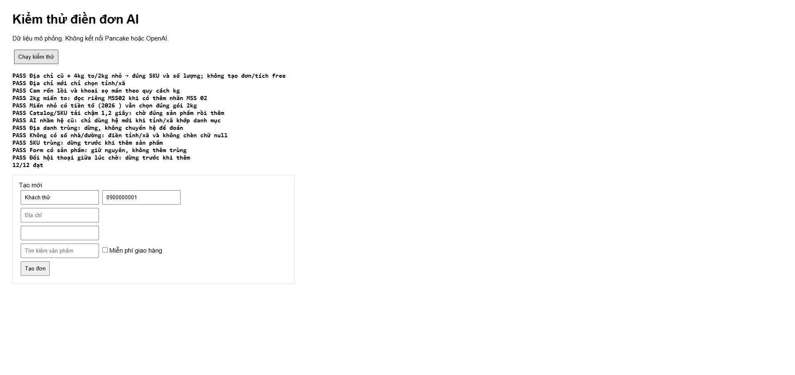

# Kiểm thử Pancake Assistant Pro 0.7.4

Ngày: 12/10/2026. Chrome trên máy người dùng; Node.js 22. Mục tiêu: hoàn thiện AI điền đơn nháp và kiểm tra các tính năng Pancake cũ.

## Kết quả

| Phạm vi | Kết quả |
| --- | --- |
| Node: schema, chat, snapshot/hủy, protocol, transport, sản phẩm, giá, POS groups | 38/38 đạt |
| Chrome: adapter AI trên DOM mô phỏng | 12/12 đạt |
| Chrome: các tính năng Pancake hiện có trên DOM mô phỏng | 15/15 đạt; observer còn hoạt động: 0 |
| Kiểm tra cú pháp | content.js, popup.js, ai-order-plan.js, ai-order-dom.js, ai-beta.js, chat-content.js, tests/ai-draft-fixture.js đạt |
| Pancake đăng nhập | Đối chiếu popup địa chỉ new/old, tên/mã SKU cam, thêm dòng nháp và đổi số lượng; dọn xong |

## 12 ca adapter AI

1. Địa chỉ cũ + 4kg miến to/2kg nhỏ: đúng SKU/số lượng, không tích free hoặc tạo đơn.
2. Địa chỉ mới: chỉ chọn tỉnh/xã.
3. Cam và khoai theo quy cách kg.
4. Hai nhãn MSS 02/MSS02: dùng mã mẫu mã MSS02.
5. Tiền tố năm `(2026 )`: chọn đúng gói miến nhỏ.
6. Danh mục/SKU tải chậm 1,2 giây: chờ rồi thêm đúng.
7. AI nhận old nhưng xã chỉ tồn tại ở new: thử new bằng cùng tên tỉnh/xã.
8. Địa danh trùng: dừng, không chuyển hệ để đoán.
9. Không có số nhà/đường: vẫn điền tỉnh/xã; không chèn null/dấu phẩy đầu.
10. SKU trùng: dừng trước thêm.
11. Form có hàng: giữ nguyên, không thêm trùng.
12. Đổi hội thoại giữa lúc chờ: dừng trước thêm.



## Kiểm tra giao diện thật

- Hệ mới của danh mục Pancake có Phường Chánh Hưng thuộc Hồ Chí Minh. Cụm “quận cũ” trong chat có thể khiến AI chọn old; adapter nay thử lại new khi old không tìm thấy tên.
- Danh mục shop có SKU cam TikTok và SKU thường. Đối chiếu đúng CAM2: 5Kg Cam Rốn Lồi Không Hạt Mộc Châu.
- Thêm CAM2 trên form trống bằng UI, đổi số lượng thành 2; xác nhận số lượng và tổng 750.000đ.
- Xóa dòng thử bằng nút xóa của Pancake; xác nhận 0 dòng/0đ, địa chỉ hành chính và chi tiết vẫn còn. Không bấm Tạo đơn, không gửi tin khách.

## Chạy lại

```powershell
node --test ai-order-plan.test.cjs chat-reader.test.cjs chat-content.test.cjs ai-protocol.test.cjs ai-transport.test.cjs product-summary.test.js pricing.test.js pos-groups.test.js
node --check content.js
node --check popup.js
node --check ai-order-dom.js
node --check ai-order-plan.js
node --check ai-beta.js
node --check chat-content.js
node --check tests/ai-draft-fixture.js
```

Fixture AI: `node tests/ai-serve.cjs`, mở http://127.0.0.1:8766 rồi bấm Chạy kiểm thử. Fixture Pancake cũ: `node tests/serve.cjs`, mở http://127.0.0.1:8765/multi_pages và chạy bộ kiểm thử trên trang. Dừng server thử sau khi xong; không dừng helper AI đang dùng ở cổng 18765.

## Giới hạn kiểm chứng và áp dụng

Công cụ trình duyệt chặn trang chrome-extension://, nên chưa kiểm chứng lượt inference + bấm Điền đơn qua extension thật sau bản sửa này. Đã kiểm tra adapter bằng chính mã nguồn mới trong Chrome và đối chiếu DOM thật. Không tạo đơn thật để kiểm thử theo AGENTS.md; việc xác nhận đơn/tag được kiểm tra bằng fixture.

Để áp dụng: tải lại extension tại chrome://extensions, tải lại tab Pancake, đóng/mở trang AI và đọc/phân tích lại. Không cần restart helper hay đăng nhập lại khi nâng từ 0.7.x. AI vẫn là Beta, đọc lịch sử hiện có trong DOM; form đã có hàng hoặc dữ liệu không khớp duy nhất sẽ dừng để xem lại. Không có khóa chống đơn trùng bền vững qua reload.
