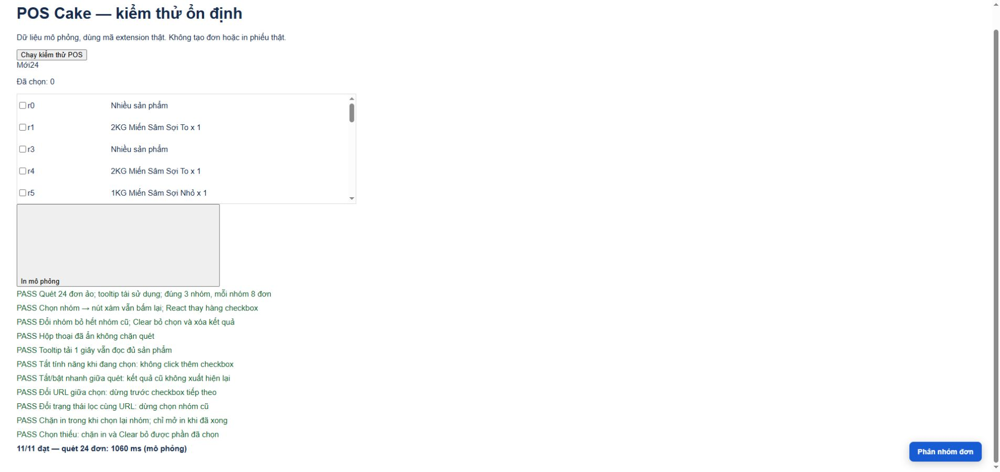

# Kiểm thử Pancake Assistant Pro 0.9.7 — 15/10/2026

## Kết quả

| Bộ kiểm thử | Kết quả | Phạm vi |
| --- | --- | --- |
| Node `node --test *.test.js *.test.cjs` | 56/56 | Giá/kg, nhóm, comment, snapshot hội thoại, AI/address/SKU, transport/OAuth với mock |
| Chrome — Pancake | 15/15 | Ghi chú, giá, tạo thủ công/tự động một lần, tag thành công/lỗi, hủy khi đổi hội thoại/sản phẩm/công tắc, dọn observer |
| Chrome — AI điền nháp | 12/12 | Địa chỉ cũ/mới, alias, SKU, catalog tải chậm, dữ liệu trùng/thiếu, hủy tác vụ |
| Chrome — POS | 11/11 | Danh sách ảo, tooltip, chọn/xám/chọn lại/Clear, hủy khi đổi URL hoặc trạng thái cùng URL, chặn in và Clear phần chọn thiếu |
| Chrome — popup | 6/6 | 8 công tắc, storage, tab, ghi nhận, mở Beta, bố cục |
| Chrome — comment bằng thao tác người dùng | 2/2 | Bấm gửi và Enter; row biến mất sau gửi, nội dung nhiều dòng; box nhắn riêng nhận `/` |
| Chrome — ưu tiên thao tác tay | 1/1 | Bấm Thông tin trong lúc chờ địa chỉ: không tự mở lại form/chọn địa chỉ |

Tổng cộng **103 ca đạt**: 56 Node và 47 Chrome. Console các trang Pancake/AI/POS/popup mô phỏng không ghi nhận lỗi hoặc cảnh báo JavaScript.



Cú pháp các JS/CJS tại thư mục gốc và `git diff --check` đạt. Chrome chạy chính các script hiện tại qua fixture HTTP cục bộ, không phải bản viết lại logic.

## Kiểm tra trên trang đang đăng nhập

- Pancake: mở Tạo mới, xác minh tab `.tab-label-item`, ô địa chỉ combobox, `.view-order`, label Miễn phí giao hàng, footer chứa Tạo đơn. Trả về Thông tin, composer vẫn trống.
- POS: vào Đơn hàng từ dashboard; xác minh holder ảo, `data-row-key`, checkbox và header/cột Sản phẩm tại chỉ số 9. DOM chứa 18 hàng trong khi bộ lọc báo 49.614 đơn: kiểm thử phải xử lý virtual list, không lấy DOM hiện tại làm toàn bộ đơn.
- Không tạo đơn, gửi comment/tin nhắn, chỉnh tag hoặc in phiếu trên dữ liệu thật. Không gửi chat thật tới AI trong lượt kiểm thử này.

## Lỗi tái hiện và sửa

1. Modal `display:none` vẫn chặn quét. Nay chỉ chặn modal đang hiển thị.
2. Tooltip mất 1 giây để tải bị đánh dấu không phân loại do giới hạn 700 ms. Nay chờ tối đa 1.500 ms, trả ngay khi có nội dung.
3. Tắt POS trong lúc chọn nhóm vẫn click tiếp checkbox. Nay dùng generation và kiểm tra ngữ cảnh sau await/trước click.
4. Đổi URL giữa chọn vẫn tác động lên danh sách. Nay dừng và yêu cầu quét lại; không khôi phục scroll lên danh sách mới.
5. Có thể bấm In trong lúc chọn lại nhóm. Nay chặn khi đang bận.
6. Checkbox tham chiếu cũ khi React thay hàng; nay đọc lại hàng/input bằng khóa sau từng thay đổi và ghi nhận từng đơn đã chọn.

## Tốc độ quan sát

- Fixture Pancake: ghi chú + giảm giá + tạo đơn mô phỏng hoàn tất khoảng **190 ms**.
- Fixture POS: quét **24 đơn / 3 nhóm** qua nhiều vùng cuộn, 8 tooltip tái sử dụng, khoảng **1.060 ms** sau sửa, tương đương trước sửa (~1.076 ms).
- Đây là số đo cục bộ, không phải cam kết tốc độ mạng/Pancake thật. Chờ tooltip chỉ kéo dài với dòng tải chậm; chu kỳ bình thường vẫn 70 ms, bước cuộn 60 ms.

## Cách chạy lại

```text
node --test *.test.js *.test.cjs
node --check content.js
node --check popup.js
node --check pos-content.js
node tests/serve.cjs
node tests/ai-serve.cjs
node tests/comment-serve.cjs
node tests/pos-serve.cjs
node tests/popup-serve.cjs
```

Mỗi máy chủ chạy ở terminal riêng. Mở lần lượt localhost 8765 `/multi_pages`, 8766 `/`, 8768 `/multi_pages`, 8769 `/shop/test/order`, 8770 `/`. Bấm nút chạy kiểm thử; ở comment, click hội thoại mẫu rồi bấm gửi, reload và thử Enter.

## Giới hạn xác minh

- Chưa nạp lại bản 0.9.7 vào extension đang cài bằng công cụ; cần Reload extension và tải lại tab trước khi sử dụng bản sửa. Chrome fixture đã nạp mã 0.9.7 trực tiếp từ dự án.
- Luồng mạng thực tạo đơn, giao nhận, máy in và AI service không được gọi để thử. Không thể bảo đảm các thay đổi phía Pancake sau này luôn tương thích.
- Khóa bộ lọc POS gồm URL và các radio đang chọn; thay đổi chỉ ở nội bộ ứng dụng mà giữ cả hai dấu hiệu vẫn cần quét lại. Sau hủy giữa chừng, checkbox đã chọn được giữ để người dùng kiểm tra/clear.
- POS content script cần tải trang ở URL Đơn hàng; nếu chuyển SPA từ trang khác và không thấy launcher, tải lại tab Đơn hàng.
